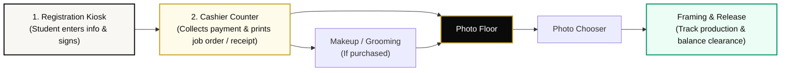

<div align="center">

# StudioFlow V2

### Offline-First Graduation Pictorial & Studio Workflow Automation

[](https://react.dev/)
[](https://www.typescriptlang.org/)
[](https://vitejs.dev/)
[](https://tailwindcss.com/)
[](https://pocketbase.io/)
[](https://microsoft.com/windows)
[](#studio-lan-setup)

[Workflow](#the-studio-workflow) -
[Quick Start](#quick-start) -
[LAN Setup](#studio-lan-setup) -
[Batch Scripts](#convenience-scripts-bat) -
[Station Guide](#station-guide) -
[Photo Storage](#photo-storage) -
[Customization](#customization)

</div>

---

## Overview

**StudioFlow V2** is a fast, paperless studio operations system built for graduation pictorial events. It runs entirely on your local studio network without needing an internet connection.

It connects the studio stations across one workflow.

- **Students** register, choose packages, and sign on a tablet or computer.
- **Cashiers** collect payments and print claim stubs and studio receipts simultaneously.
- **Makeup artists** claim paid students who purchased makeup or grooming and send them to the photo floor once preparation is complete.
- **Photographers** get a live queue of paid clients with automatically generated photo folders.
- **Choosers** help students review and confirm photos after the shoot.
- **Administrators** track framing status, release deliverables, and export daily accounting reports.

---

## The Studio Workflow



---

## Quick Start

### Prerequisites

- **Operating System**: Windows 10 or 11
- **Runtime**: [Node.js](https://nodejs.org/) 22.13+ on the Node 22 release line, or Node 24+ (for building and development)
- **Database Engine**: `pocketbase.exe` (included in the repository root)

### 1-Click Launch (Recommended for Studio Staff)

Simply double-click:

```bash
run.bat
```

The script automatically:

1. Detects your physical studio Wi-Fi / LAN IP address.
2. Starts the backend server on `0.0.0.0:8090`.
3. Displays the exact URLs for tablets, cashier laptops, and phone kiosks on your screen.

> **Tip (Single-Port Mode)**: Run `run.bat --build` to compile and bundle the web app directly into PocketBase. This serves both the database and the web application from a single port (`8090`), so other devices don't need a separate Node.js terminal running.

### Developer Mode (Live Reloading)

If developing or modifying frontend components:

```bash

# Terminal 1: Start Backend
.\pocketbase.exe serve --http="127.0.0.1:8090"

# Terminal 2: Start Frontend with HMR
npm i
npm run dev
```

Open **`http://localhost:5173`** in your browser.

---

## Convenience Scripts (`.bat`)

StudioFlow includes pre-built batch scripts to simplify studio operations:

| Script | How to Run | What It Does |
| :--- | :--- | :--- |
| **`run.bat`** | Double-click or `.\run.bat` | **1-Click Server Launch**. Detects studio LAN IP, binds server, and shows connect URLs. |
| **`run.bat --build`** | `.\run.bat --build` | Builds the frontend and deploys it to `pb_public` for single-port serving (`:8090`). |
| **`scripts\backup.bat`** | Double-click | Creates a timestamped snapshot of the database (`pb_data\`) into `backups\`. |
| **`scripts\restore.bat`** | Double-click | Restores the database from a previous backup snapshot. |
| **`scripts\clean_orphans.bat`** | Double-click | Previews or removes empty client folders that have no matching Job Order or saved binding. |
| **`scripts\migrate-photo-folders.bat`** | Command Prompt | Previews photo folder renames. Use `--apply` to migrate or `--resume` to continue an interrupted migration. |
| **`scripts\reset-for-handover.bat`** | Double-click (server closed) | Removes all test data before handover so numbering starts at Job Order 00001 / OR-000001. Backs up first. It can keep the setup (schools, packages, staff) or create a factory-fresh database. |

---

## Station Guide

| Station | Route | Default Users | Key Responsibilities |
| :--- | :--- | :--- | :--- |
| **Registration Kiosk** | `/#/register` | Public (Students) | Select school, course, and pictorial package; dynamic add-on selection; digital signature capture; instant Job Order assignment (`№ 00001`). |
| **Cashier Counter** | `/#/cashier` | `cashier`, `admin` | Search client by Job Order or name; collect downpayment or full payment with cash received and change; print the **job order sheet** (letter: customer claim stub + studio copy) after the first payment and a **small payment receipt**, a third of a letter sheet (customer + studio copy), after later payments. |
| **Makeup / Grooming** | `/#/mua` | `mua`, `admin` | MUAs claim, start, and complete preparation. Admins can release a stalled assignment to the waiting queue. |
| **Photo Floor** | `/#/photographer` | `photographer`, `admin` | Live queue for paid students after any required preparation. **Copy Path** retrieves the assigned folder path. |
| **Photo Chooser** | `/#/chooser` | `chooser`, `admin` | Search completed shoots, preview photos, confirm selections, and reopen a selection to revise it. |
| **Studio Admin** | `/#/admin` | `admin` | Manage staff and catalog settings. Monitor makeup assignments and photo selection under **Makeup & Photo Selection**. |

Create staff accounts in **Admin → Staff Accounts**. In **Packages & Add-ons**, classify a standalone makeup or grooming charge as **Other Payment — MUA**, then enable **This is an MUA Service**. Price makeup in a portrait bundle as its own add-on. Catalog edits apply to new purchases. To correct an existing order before photography, use **Clients Directory → Edit Client → Correct MUA requirement**. Release any active MUA assignment first. Set **Photo selection limit** to the allowed number of photographs. A value of `0` allows any number.

**Analytics & Overview → MUA Performance Analytics** shows completed service counts and earnings by catalog item for the selected Asia/Manila date. Select an artist to inspect their completions, recorded adjustments, and refunds or voids awaiting review. CSV exports match the daily totals. The Earnings Excel export includes an audit sheet. Historical completions with ambiguous catalog references retain their original column and earnings with a review flag.

---

## Studio LAN Setup

Run StudioFlow across all studio tablets, laptops, and PCs using a single Wi-Fi router (no internet required):

```
                       [ Studio Wi-Fi Router ]
                                  │
         ┌────────────────────────┼────────────────────────┐
         │                        │                        │
[ Server PC ]              [ Cashier Laptop ]        [ Registration Tablet ]
Host IP: 192.168.1.50      http://192.168.1.50:8090  http://192.168.1.50:8090
Runs run.bat               (Cashier Counter)         (Public Student Kiosk)
```

1. **Launch `run.bat`** on the main studio computer.
2. Note the IP displayed in the console (e.g. `192.168.1.50`).
3. Open any browser on devices connected to the studio Wi-Fi:
   - **Student Kiosks / Tablets**: `http://192.168.1.50:8090/#/register`
   - **Cashier Terminal**: `http://192.168.1.50:8090/#/cashier`
   - **Photographer PC**: `http://192.168.1.50:8090/#/photographer`
   - **Makeup station**: `http://192.168.1.50:8090/#/mua`
   - **Chooser station**: `http://192.168.1.50:8090/#/chooser`

Leave `VITE_PB_URL` unset for the normal LAN setup so each browser uses the studio server's address. If you need to set it, use an address reachable by all stations.

---

## Photo Storage

The PocketBase server creates photo directories under `C:\StudioFlow_Photos` by default. To use another location, set `STUDIOFLOW_PHOTOS_ROOT` to its absolute path in the server process environment before launching PocketBase. Use a volume that supports hard links, such as NTFS, and give PocketBase read and write access.

```
C:\StudioFlow_Photos\
  └── [School Code]\
        └── [Course Code]\
              └── 0018_Dela_Cruz_Juan_Santos\
                    ├── 0018_Dela_Cruz_Juan_Santos\
                    └── Unselected\
```

**Camera auto-import:** in **Admin → Camera Import** (or **Set Up** on the Photo Floor), add a camera and choose its output folder on the server PC with **Browse**. Set the same folder as the save folder in the camera's tethering or Wi-Fi transfer software. On the Photo Floor, pick the camera for that device. **Call Client** links the camera to the client, every finished shot moves into the client's job folder within a few seconds, and **Mark Done** sends the last shots and unlinks the camera. Photos taken with no client linked stay in the camera folder until someone sends them to a client.

Use **Copy Path** in the photographer queue to find the server folder for a job order. From a remote station, use your studio's file share for that folder. Put finished exports in the job folder or `Unselected`. Opening the gallery moves supported exports from the job folder into `Unselected`. Confirmed selections move into the subfolder named after the job folder. RAW files and unrecognized files stay where the photographer placed them.

Existing folders keep working under their saved names. To rename them, stop PocketBase and pause writes to the photo share, then back up the database and photo root together. From the StudioFlow directory run `node scripts/migrate-photo-folders.cjs "<path to data.db>" "<photo root>"` to preview. Review unmatched or skipped folders, then add `--apply` to rename verified bindings and update the database. For an interrupted migration, keep PocketBase stopped and use `--resume` with the same paths. If recovery requires restoring a backup, restore both the database and photo root together. An unbound legacy folder can be attached using **Copy Path** once its unique job order and folder have been verified.

If a transfer pauses, restore access to the original files and choose **Resume transfer** on the student card. Keep the photo root and the database backed up together. The database contains folder mappings and any unfinished transfers.

---

## Security & Staff Accounts

The database enforces a **Zero-Trust Rule Model**:
- The public kiosk can read the catalog, submit registrations, and read the active queue count.
- Financial ledgers and full registration details are restricted by staff role. Makeup and Chooser stations receive the student details needed for their workflow.
- Deletions, pricing edits, and school roster management are restricted to `admin`.

### Default Staff Usernames

| Role | Username | Station Access |
| :--- | :--- | :--- |
| **Cashier** | `cashier` | Cashier Counter |
| **Photographer** | `photographer` | Photo Floor Queue & Shoot History |
| **Administrator** | `admin` | Full System & Dashboard Access |

---

## Customization

To update studio branding, telephone numbers, address, or receipt terms, edit:

```
src/constants/studio.ts
```

All studio constants (studio name, tagline, hours, contact numbers, starting receipt number, and terms clauses) are maintained in this single source of truth.

---

## Available Scripts

### Build from the Windows CLI

From the StudioFlow project directory in PowerShell or Command Prompt, install the locked dependencies and run the build script:

```text
npm.cmd ci
.\scripts\build.bat
```

Run `npm.cmd ci` on a fresh checkout or after the dependency lockfile changes. The build script runs type checking and writes the production build to `dist\`. It returns a nonzero exit code on failure.

To build, deploy to PocketBase, and start the server on port 8090, run:

```text
.\run.bat --build
```

| Command | Description |
| :--- | :--- |
| `run.bat` | 1-Click launcher with auto-detected studio LAN IP |
| `run.bat --build` | Builds frontend and serves unified app on port 8090 |
| `npm run dev` | Starts local development server with hot-reload |
| `scripts\build.bat` | Type-checks and builds the frontend into `dist\` |
| `npm run build` | Bundles production-optimized static assets to `/dist` |
| `npm run lint` | Runs ESLint type and code quality checks |
| `npm run test:workflow` | Runs the isolated PocketBase integration suite with Node.js 22.13+ |
| `npm run seed:graduation` | Adds the six graduation brochure packages as drafts |

### Seed graduation packages for demo and handover

Start StudioFlow with `run.bat` and leave the server window open. PocketBase applies the package builder migration on startup. In a separate PowerShell window, use a StudioFlow admin account to add the six brochures under **Admin → Packages & Add-ons**.

```powershell
$studioPassword = Read-Host "StudioFlow admin password" -AsSecureString
$env:STUDIOFLOW_ADMIN_PASSWORD = [pscredential]::new('studioflow', $studioPassword).GetNetworkCredential().Password
npm run seed:graduation
Remove-Item Env:STUDIOFLOW_ADMIN_PASSWORD
```

The script defaults to the `admin` staff account at `http://127.0.0.1:8090`. Set `STUDIOFLOW_ADMIN_USER` or `STUDIOFLOW_PB_URL` to use a different account or server. Use `npm run seed:graduation -- --publish` on a mock database to make newly added packages available in the school booking form immediately. Each run skips codes already in the catalog, including drafts. Publish any previously seeded drafts from the Admin catalog after reviewing the brochure discrepancies. The handover reset's **Keep setup** mode preserves the seeded packages.

---
