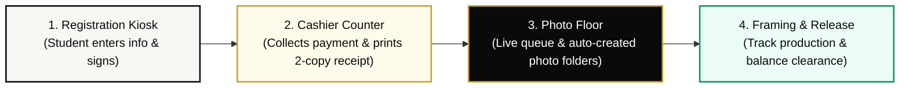

<div align="center">

# StudioFlow V2

### Offline-First Graduation Pictorial & Studio Workflow Automation

[](https://react.dev/)
[](https://www.typescriptlang.org/)
[](https://vitejs.dev/)
[](https://tailwindcss.com/)
[](https://pocketbase.io/)
[](https://microsoft.com/windows)
[](#studio-lan-setup)

[Workflow](#the-studio-workflow) -
[Quick Start](#quick-start) -
[LAN Setup](#studio-lan-setup) -
[Batch Scripts](#convenience-scripts-bat) -
[Station Guide](#station-guide) -
[Photo Storage](#photo-storage) -
[Customization](#customization)

</div>

---

## Overview

**StudioFlow V2** is a fast, paperless studio operations system built for graduation pictorial events. It runs entirely on your local studio network without needing an internet connection.

It connects four stations into one seamless pipeline:

- **Students** register, choose packages, and sign on a tablet or computer.
- **Cashiers** collect payments and print claim stubs and studio receipts simultaneously.
- **Photographers** get a live queue of paid clients with automatically generated photo folders.
- **Administrators** track framing status, release deliverables, and export daily accounting reports.

---

## The Studio Workflow



---

## Quick Start

### Prerequisites

- **Operating System**: Windows 10 or 11
- **Runtime**: [Node.js](https://nodejs.org/) v18+ (for initial build or dev server)
- **Database Engine**: `pocketbase.exe` (included in the repository root)

### 1-Click Launch (Recommended for Studio Staff)

Simply double-click:

```bash
run.bat
```

The script automatically:

1. Detects your physical studio Wi-Fi / LAN IP address.
2. Starts the backend server on `0.0.0.0:8090`.
3. Displays the exact URLs for tablets, cashier laptops, and phone kiosks on your screen.

> **Tip (Single-Port Mode)**: Run `run.bat --build` to compile and bundle the web app directly into PocketBase. This serves both the database and the web application from a single port (`8090`), so other devices don't need a separate Node.js terminal running.

### Developer Mode (Live Reloading)

If developing or modifying frontend components:

```bash

# Terminal 1: Start Backend
.\pocketbase.exe serve --http="127.0.0.1:8090"

# Terminal 2: Start Frontend with HMR
npm run dev
```

Open **`http://localhost:5173`** in your browser.

---

## Convenience Scripts (`.bat`)

StudioFlow includes pre-built batch scripts to simplify studio operations:

| Script | How to Run | What It Does |
| :--- | :--- | :--- |
| **`run.bat`** | Double-click or `.\run.bat` | **1-Click Server Launch**. Detects studio LAN IP, binds server, and shows connect URLs. |
| **`run.bat --build`** | `.\run.bat --build` | Builds the frontend and deploys it to `pb_public` for single-port serving (`:8090`). |
| **`scripts\backup.bat`** | Double-click | Creates a timestamped snapshot of the database (`pb_data\`) into `backups\`. |
| **`scripts\restore.bat`** | Double-click | Restores the database from a previous backup snapshot. |
| **`scripts\clean_orphans.bat`** | Double-click | Scans and safely prunes empty or cancelled student photo folders on disk. |

---

## Station Guide

| Station | Route | Default Users | Key Responsibilities |
| :--- | :--- | :--- | :--- |
| **Registration Kiosk** | `/#/register` | Public (Students) | Select school, course, and pictorial package; dynamic add-on selection; digital signature capture; instant Job Order assignment (`№ 00001`). |
| **Cashier Counter** | `/#/cashier` | `cashier`, `admin` | Search client by Job Order or name; collect downpayment or full payment; 1-click simultaneous print for **Page 1 (Yellow Customer Copy)** and **Page 2 (White Studio Accounting Copy)**. |
| **Photo Floor** | `/#/photographer` | `photographer`, `admin` | Live queue of paid students; 1-click **Copy Folder Path** directly into Windows File Explorer; photo shoot progress tracking (`shot_raw`, `client_selected`, `ready_to_print`). |
| **Studio Admin** | `/#/admin` | `admin` | Manage school rosters, courses, and package pricing; track production framing stages; enforce zero-balance rule before release; export daily accounting CSV reports. |

---

## Studio LAN Setup

Run StudioFlow across all studio tablets, laptops, and PCs using a single Wi-Fi router (no internet required):

```
                       [ Studio Wi-Fi Router ]
                                  │
         ┌────────────────────────┼────────────────────────┐
         │                        │                        │
[ Server PC ]              [ Cashier Laptop ]        [ Registration Tablet ]
Host IP: 192.168.1.50      http://192.168.1.50:8090  http://192.168.1.50:8090
Runs run.bat               (Cashier Counter)         (Public Student Kiosk)
```

1. **Launch `run.bat`** on the main studio computer.
2. Note the IP displayed in the console (e.g. `192.168.1.50`).
3. Open any browser on devices connected to the studio Wi-Fi:
   - **Student Kiosks / Tablets**: `http://192.168.1.50:8090/#/register`
   - **Cashier Terminal**: `http://192.168.1.50:8090/#/cashier`
   - **Photographer PC**: `http://192.168.1.50:8090/#/photographer`

---

## Photo Storage

Photo directories are automatically created on the server computer under `C:\StudioFlow_Photos`:

```
C:\StudioFlow_Photos\
  └── [School Code]\
        └── [Course Code]\
              └── [JobOrder]_[FamilyName]_[GivenName]\
```

**Example Folder**:
```
C:\StudioFlow_Photos\ACLC-MND\BSIT\00001_Cando_Manuel\
```

Photographers click **"Copy Path"** on the queue card to paste the exact folder directly into File Explorer, Lightroom, or tethering software.

---

## Security & Staff Accounts

The database enforces a **Zero-Trust Rule Model**:
- Anonymous clients can only register and read active queue counters.
- Financial ledgers and student contact information are restricted to authenticated staff.
- Deletions, pricing edits, and school roster management are restricted to `admin`.

### Default Staff Usernames

| Role | Username | Station Access |
| :--- | :--- | :--- |
| **Cashier** | `cashier` | Cashier Counter |
| **Photographer** | `photographer` | Photo Floor Queue & Shoot History |
| **Administrator** | `admin` | Full System & Dashboard Access |

---

## Customization

To update studio branding, telephone numbers, address, or receipt terms, edit:

```
src/constants/studio.ts
```

All studio constants (studio name, tagline, hours, contact numbers, starting receipt number, and terms clauses) are maintained in this single source of truth.

---

## Available Scripts

| Command | Description |
| :--- | :--- |
| `run.bat` | 1-Click launcher with auto-detected studio LAN IP |
| `run.bat --build` | Builds frontend and serves unified app on port 8090 |
| `npm run dev` | Starts local development server with hot-reload |
| `npm run build` | Bundles production-optimized static assets to `/dist` |
| `npm run lint` | Runs ESLint type and code quality checks |

---